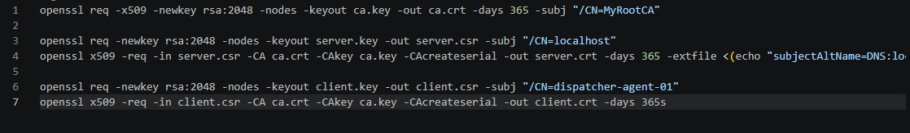
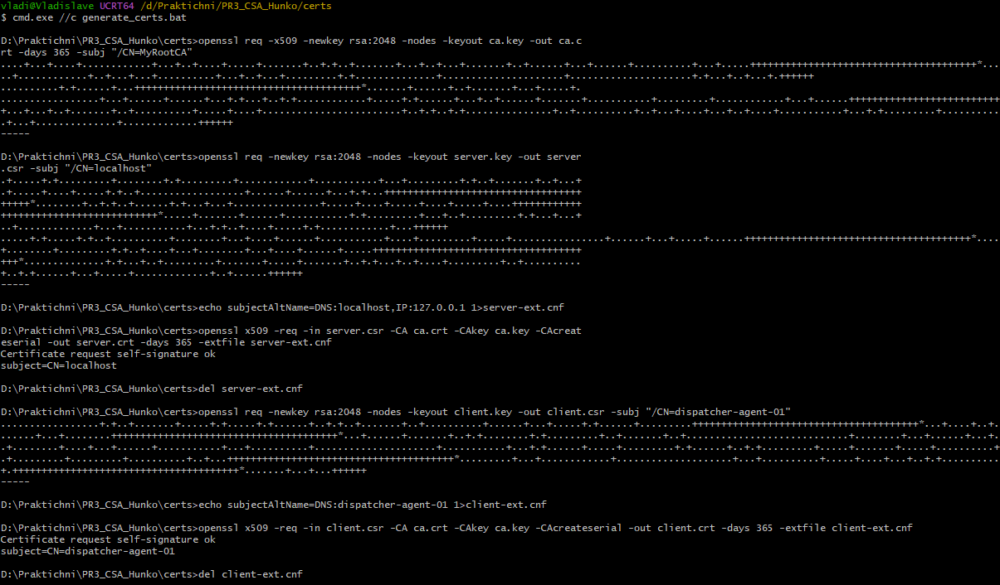
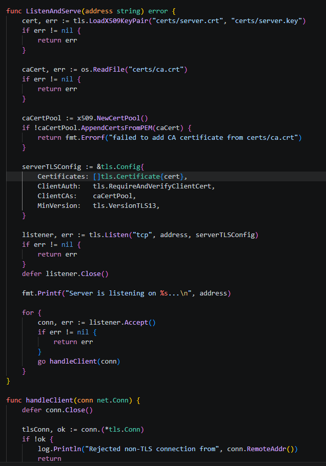
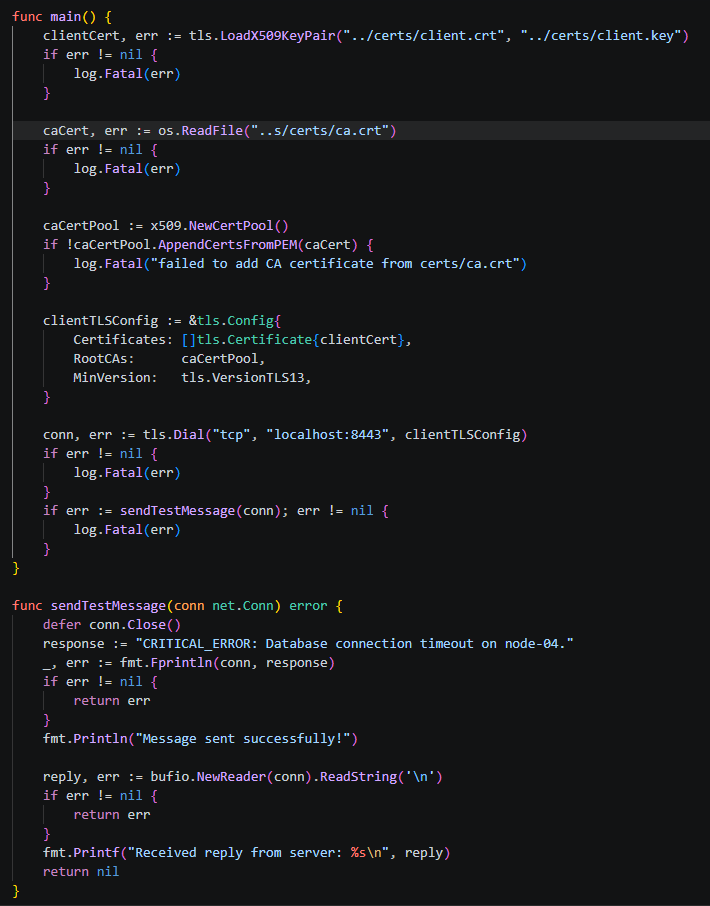
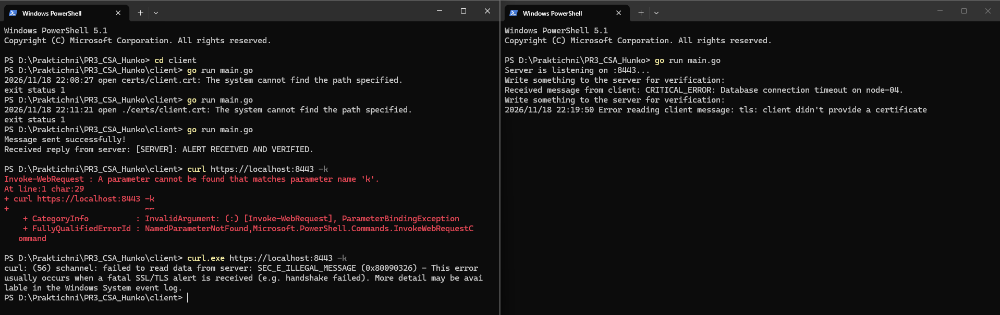
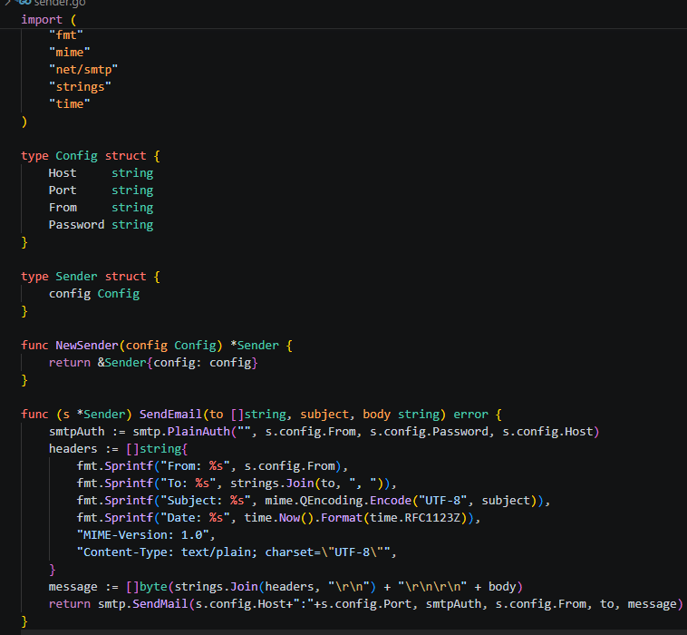
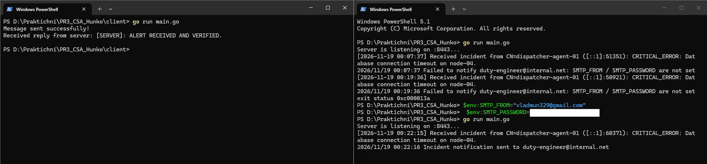
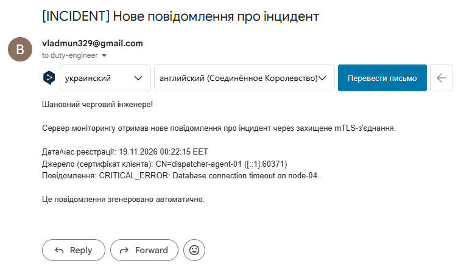

# Практична робота № 3

## Налаштування захищеного каналу mTLS та протокол SMTP

**Secure Alert Gateway** — консольний шлюз критичних сповіщень на Go. Сервер приймає повідомлення про інциденти лише від клієнтів із сертифікатом, підписаним спільним Root CA (mTLS), а після успішного прийому автоматично надсилає лист черговому інженеру через SMTP.

---

## Зміст

1. [Мета роботи](#мета-роботи)
2. [Що реалізовано](#що-реалізовано)
3. [Структура проєкту](#структура-проєкту)
4. [Вимоги](#вимоги)
5. [Інструкція запуску](#інструкція-запуску)
6. [Хід роботи та результати](#хід-роботи-та-результати)
7. [Відповіді на контрольні питання](#відповіді-на-контрольні-питання)
8. [Висновки](#висновки)

---

## Мета роботи

- Опанувати принципи PKI та генерацію сертифікатів X.509 (Root CA, серверний і клієнтський сертифікати).
- Налаштувати захищені TCP-з'єднання на базі `crypto/tls` із двосторонньою автентифікацією (mTLS).
- Опанувати надсилання пошти через `net/smtp` та STARTTLS.

---

## Що реалізовано

| Рівень | Завдання | Статус |
|---|---|---|
| **1. Базовий** | Генерація PKI, mTLS-сервер, mTLS-клієнт, перевірка відхилення неавторизованого доступу | Виконано |
| **2. Ключовий** | Пакет для відправки email, автоматичне сповіщення чергового інженера після прийому інциденту | Виконано |
| **3. Просунутий** | Повний аудит сертифіката (серійний номер, термін дії), MIME HTML + вкладення | Не виконано (частково: CN клієнта вже потрапляє в лог і в лист) |

**Як це працює:**

1. Клієнт з'єднується з сервером `localhost:8443` по TLS 1.3 і пред'являє сертифікат `client.crt`.
2. Сервер перевіряє його за `ca.crt` (`tls.RequireAndVerifyClientCert`). Без валідного сертифіката рукостискання завершується помилкою.
3. Сервер читає повідомлення, фіксує час реєстрації та CN клієнта із сертифіката, відповідає `[SERVER]: ALERT RECEIVED AND VERIFIED.`
4. Сервер викликає `SendIncidentNotification`, яка надсилає лист на `duty-engineer@internal.net` з текстом інциденту, датою/часом реєстрації та ідентифікатором клієнта.

---

## Структура проєкту

```
PR3_CSA_Hunko/
├── main.go                 # точка входу: запуск mTLS-сервера на :8443
├── go.mod
├── certs/
│   ├── generate_certs.bat  # скрипт генерації PKI (Windows)
│   ├── ca.crt / ca.key     # кореневий центр сертифікації
│   ├── server.crt / .key   # сертифікат сервера (SAN: localhost, 127.0.0.1)
│   └── client.crt / .key   # сертифікат клієнта (CN=dispatcher-agent-01)
├── server/
│   ├── main.go             # mTLS-сервер, обробка клієнта
│   └── notify.go           # формування та відправка листа про інцидент
├── client/
│   └── main.go             # mTLS-клієнт, надсилає тестовий інцидент
├── smtp/
│   ├── sender.go           # пакет smtp: Config, Sender, SendEmail
│   └── cmd/main.go         # окрема утиліта для тестового листа
└── screenshots/            # скриншоти для звіту
```

---

## Вимоги

- Go 1.22 або новіший
- OpenSSL (є в Git for Windows, використовується скриптом генерації сертифікатів)
- Поштовий акаунт із паролем застосунку (Gmail) **або** локальний емулятор Mailpit / MailHog

---

## Інструкція запуску

### 1. Генерація сертифікатів

Із папки `certs`:

```bash
cd certs
cmd.exe //c generate_certs.bat     # Git Bash
# або в PowerShell / cmd:  .\generate_certs.bat
```

Скрипт створює `ca.*`, `server.*`, `client.*`. Для сервера у розширенні SAN вказано `DNS:localhost, IP:127.0.0.1`.

### 2. Налаштування SMTP

SMTP-параметри беруться зі змінних оточення, щоб пароль не потрапляв у код і репозиторій.

| Змінна | Призначення | За замовчуванням |
|---|---|---|
| `SMTP_FROM` | адреса відправника / логін | — (обов'язкова) |
| `SMTP_PASSWORD` | пароль (для Gmail — пароль застосунку) | — (обов'язкова) |
| `SMTP_HOST` | SMTP-сервер | `smtp.gmail.com` |
| `SMTP_PORT` | порт (587, STARTTLS) | `587` |

PowerShell:

```powershell
$env:SMTP_FROM="your_mail@gmail.com"
$env:SMTP_PASSWORD="xxxx xxxx xxxx xxxx"
```

> Змінні діють лише в тому вікні, де їх задано. Задавати їх потрібно у вікні **сервера**.

Для Mailpit (без авторизації в Gmail): `docker run -d -p 1025:1025 -p 8025:8025 axllent/mailpit`, потім `SMTP_HOST=localhost`, `SMTP_PORT=1025`.

### 3. Запуск сервера (вікно 1, з кореня проєкту)

```powershell
cd D:\Praktichni\PR3_CSA_Hunko
go run main.go
```

```
Server is listening on :8443...
```

### 4. Запуск клієнта (вікно 2, з папки `client`)

```powershell
cd D:\Praktichni\PR3_CSA_Hunko\client
go run main.go
```

### 5. Перевірка відхилення неавторизованого доступу

У PowerShell `curl` — це аліас `Invoke-WebRequest`, тому потрібен `curl.exe`:

```powershell
curl.exe https://localhost:8443 -k
```

Або через OpenSSL: `openssl s_client -connect localhost:8443` (без `-cert`).

---

## Хід роботи та результати

### Рівень 1. Генерація PKI та mTLS-шлюз

#### 1.1 Скрипт генерації сертифікатів

Скрипт `certs/generate_certs.bat` послідовно створює Root CA, сертифікат сервера (з SAN) та сертифікат клієнта (`CN=dispatcher-agent-01`), підписані цим CA.



#### 1.2 Результат виконання скрипту



Повідомлення `Certificate request self-signature ok` для сервера й клієнта означає, що CSR підписано успішно, а `subject=CN=localhost` та `subject=CN=dispatcher-agent-01` підтверджують коректні суб'єкти сертифікатів.

#### 1.3 mTLS-сервер

Сервер (`server/main.go`) налаштовано з політикою `tls.RequireAndVerifyClientCert`, `ClientCAs` із `ca.crt` та `MinVersion: TLS 1.3`. Після рукостискання з `ConnectionState().PeerCertificates` береться CN клієнта.



#### 1.4 mTLS-клієнт

Клієнт (`client/main.go`) підключає `client.crt` / `client.key` і довірений `ca.crt`, підключається через `tls.Dial` і надсилає повідомлення `CRITICAL_ERROR: Database connection timeout on node-04.`



#### 1.5 Тестування: авторизований клієнт та відхилення неавторизованого

Ліве вікно — клієнт із сертифікатом: повідомлення надіслано, сервер повернув `ALERT RECEIVED AND VERIFIED`. Спроба підключитись через `curl.exe` без сертифіката завершується помилкою TLS `SEC_E_ILLEGAL_MESSAGE`, а в консолі сервера з'являється `tls: client didn't provide a certificate` — з'єднання розірвано під час рукостискання.

> Перші два запуски клієнта на скриншоті завершились помилкою `The system cannot find the path specified` — клієнт запускався з папки `client`, а шлях до сертифікатів був вказаний неправильно. Після виправлення шляхів (`../certs/...`) усе запрацювало.



---

### Рівень 2. Автоматична відправка email-сповіщень через SMTP

#### 2.1 Модуль відправки пошти

Пакет `smtp` (`smtp/sender.go`) містить `Config`, `Sender` та параметризований метод `SendEmail(to, subject, body)`. Він формує заголовки `From`, `To`, `Subject` (тема кодується через `mime.QEncoding`, тому кирилиця у темі читається коректно), `Date`, `MIME-Version`, `Content-Type: text/plain; charset="UTF-8"` та відправляє лист через `smtp.SendMail` із `smtp.PlainAuth` (STARTTLS на порту 587).



#### 2.2 Інтеграція з сервером

Після успішного прийому повідомлення сервер викликає `SendIncidentNotification` (`server/notify.go`). Адресат — `duty-engineer@internal.net`. Якщо відправка не вдалась (наприклад, не задано `SMTP_*`), помилка записується в лог, а клієнт усе одно отримує підтвердження прийому.

На скриншоті видно обидва сценарії: спочатку без змінних `SMTP_FROM` / `SMTP_PASSWORD` сервер повідомляє `Failed to notify ... SMTP_FROM / SMTP_PASSWORD are not set`, а після їх задання — `Incident notification sent to duty-engineer@internal.net`.



#### 2.3 Отриманий лист

У листі: текст інциденту, дата/час реєстрації події на сервері та джерело — CN із клієнтського сертифіката.



---

### Рівень 3. Просунутий (не виконано)

Не реалізовано: MIME `multipart/mixed` (HTML-розмітка + вкладення `incident_report.log` у Base64), виведення серійного номера й терміну дії сертифіката клієнта. Частково враховано: CN клієнта (`Subject.CommonName`) із `PeerCertificates` уже записується в лог сервера й у лист.

---

## Відповіді на контрольні питання

1. **Різниця TLS і mTLS.** У звичайному TLS сертифікат пред'являє лише сервер, а клієнт його перевіряє. У mTLS сертифікат також пред'являє й перевіряє сервер, тож обидві сторони автентифікуються під час рукостискання.
2. **`tls.RequireAndVerifyClientCert`.** Сервер обов'язково вимагає клієнтський сертифікат і перевіряє його підпис за пулом `ClientCAs`. Без валідного сертифіката рукостискання завершується помилкою.
3. **Чому mTLS у Zero Trust.** Секретом є приватний ключ, який не передається мережею, на відміну від пароля чи API-ключа в заголовку. Ідентичність перевіряється на транспортному рівні для кожного з'єднання, сертифікати мають термін дії й можуть бути відкликані.
4. **SAN.** Subject Alternative Name — перелік доменних імен та IP, для яких дійсний сертифікат. Поле CN неоднозначне й не підтримує кілька імен, тому RFC 6125 його не рекомендує, а сучасні браузери та Go перевіряють лише SAN.
5. **STARTTLS (587) та SMTP over SSL/TLS (465).** При STARTTLS з'єднання спочатку відкривається у відкритому вигляді, а потім командою `STARTTLS` підвищується до TLS. На порту 465 TLS встановлюється одразу, до початку SMTP-діалогу.
6. **MIME Multipart та `boundary`.** Лист складається з кількох частин (текст, HTML, вкладення), кожна зі своїми заголовками. `boundary` — унікальний рядок-розділювач, за яким клієнт розбиває тіло листа на частини.
7. **Base64 для вкладень.** SMTP історично передає лише 7-бітний текст, а бінарні дані можуть містити керівні символи та байти, що ламають протокол. Base64 перетворює їх на безпечні ASCII-символи.
8. **Переваги Mailpit / MailHog.** Листи нікуди не відправляються, тож не потрібні реальні акаунти й паролі, немає ризику розіслати тестові листи, усе перевіряється у вебінтерфейсі, а тести повторювані й швидкі.

---

## Висновки

У роботі побудовано захищений шлюз сповіщень: сервер пропускає лише клієнтів із сертифікатом спільного CA, фіксує їх ідентифікатор із сертифіката і автоматично сповіщає чергового інженера електронною поштою про кожен прийнятий інцидент. Спроба підключення без сертифіката відхиляється на етапі TLS-рукостискання. Рівні 1 і 2 виконано повністю й перевірено; рівень 3 (MIME HTML + вкладення, розширений аудит сертифіката) залишається як подальший розвиток.

### Примітки щодо безпеки

- Пароль SMTP не зберігається в коді — лише у змінних оточення. Якщо пароль застосунку десь засвітився (скриншот, коміт), його варто відкликати й створити новий.
- Приватні ключі в `certs/*.key` призначені лише для навчального стенду; у реальному проєкті їх не додають до репозиторію.
